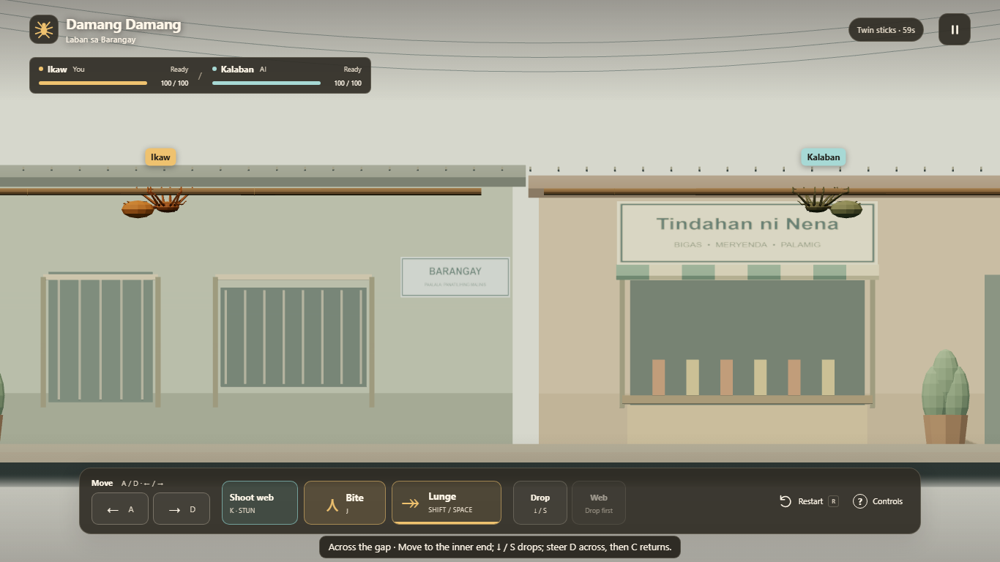

# Damang Damang

A local browser fighting game inspired by spider fighting on twigs in the Philippines. Bite, dodge, and use silk to return to the arena in a barangay street scene.



## Play locally

Requires Node.js 20.19+ or 22.12+ and a browser with WebGL support.

```sh
npm ci
npm run dev
```

Open the URL printed by Vite. Choose **Bot Match** or local **PvP** after loading. Keyboard and touch work without controllers; optional browser-standard controllers keep their P1/P2 slots across rounds.

## Controls

| Action         | Bot Match      | PvP P1 | PvP P2 | Standard controller          |
| -------------- | -------------- | ------ | ------ | ---------------------------- |
| Move           | A / D or ← / → | A / D  | ← / →  | D-pad / left stick ← / →     |
| Bite           | J              | Q      | ,      | Left face (Xbox X)           |
| Shoot web      | K              | E      | .      | Top face (Xbox Y)            |
| Lunge          | Shift / Space  | F      | /      | Bottom face (Xbox A)         |
| Drop           | S / ↓          | S      | ↓      | D-pad ↓                      |
| Silk return    | C              | W      | ↑      | Right face (Xbox B)          |
| Pause / resume | Esc            | Esc    | Esc    | Start / Options              |
| Restart        | R              | R      | R      | Bottom face on result screen |

Touch PvP supplies a separate control set for each fighter; landscape is recommended. The pause dialog can switch back to one touch set, which requires another input for P2. Controller bindings follow physical button positions; printed PlayStation and Switch labels differ. Press and release a controller button to connect it. In PvP, one controller takes P2 alongside keyboard/touch P1; two controllers take P1 and P2. D-pad navigates menus; bottom face confirms. Back/Share restarts a running match. Release held controller buttons after starting, resuming, or restarting before playing.

Move close enough to bite, or shoot a web to briefly stun the opponent. Drop or retreat to evade; while falling or grounded, cast silk and steer to swing back. Choose One stick, Twin sticks, Stepped sticks or Terraces before starting. Lunges have a committed windup, a 30-damage strike that evades webs, and punishable recovery. Ground impact deals 10 damage, then 5 per second on the pavement. A round ends at zero health or after 60 seconds; higher health wins at timeout, with equal health a draw. Win two rounds to win the match; draws replay. Optional first-match coaching teaches movement, webs and bites, and remembers completion or skipping. The pause dialog contains complete controls, a button-hint switch, sound mute, and a way to change mode or arena. Sounds are synthesized in the browser after your first interaction.

Stepped sticks is a two-stick uphill/downhill crossing. Terraces has two raised starting perches around a lower center fighting stick; chase across two gaps, or meet in the middle.

## Build and checks

```sh
npm run format:check
npm test
npm run build
node scripts/check-deployment.mjs
npx playwright install chromium
npm run test:browser
npm run preview
```

The build is written to `dist/`. Relative URLs support deployment beneath a subfolder. The deployment check serves the production build under `/damang-damang/` and checks HTML, JavaScript, CSS, and the GLB model over HTTP; it does not render the game.

CI runs tests, a production build, the deployment check, and Chromium browser checks on pull requests and pushes to `main`. Only a successful run on `main` can upload and deploy to GitHub Pages. Repository administrators must select **GitHub Actions** as the Pages source; that setting and a live deployment have not been verified here. No published play link or gameplay capture is claimed.

See [MECHANICS.md](MECHANICS.md) for simulation rules, [ISSUE-STATUS.md](ISSUE-STATUS.md) for review coverage, and [QA.md](QA.md) for the hands-on checks before release. [SUBMISSION.md](SUBMISSION.md) contains the team submission checklist and draft AI-usage notes.

## Assets and credits

The low-poly spider was created procedurally in Blender for this project. Its editable source is `assets/source/spider_anatomy_lowpoly.blend`; `scripts/export_spider.py` prepares the browser model at `public/models/spider.glb` without saving over the source. The street, twig, holder, and props are procedural scene geometry.

The bite pose takes motion reference from [Vibi's “Spider Attack Animation1”](https://www.youtube.com/watch?v=vBbR2uFKEls). No video artwork is bundled. Rendering uses [Three.js](https://threejs.org/) and its GLTFLoader; dependency license terms remain in their packages. No project license file is currently provided, so this README does not grant redistribution rights for the project or model.
